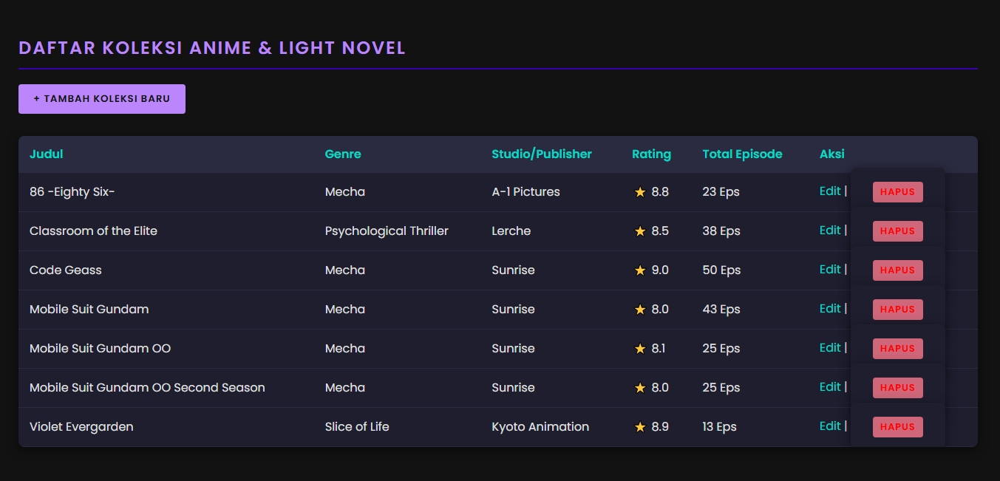

# Tugas 8 - CRUD Manajemen Koleksi Anime & Light Novel

Repository ini berisi Tugas Rutin 8 untuk mata kuliah Pemrograman Web. Aplikasi ini adalah sistem CRUD (Create, Read, Update, Delete) yang dibangun menggunakan **PHP Native** dan **MySQL** dengan pendekatan **PDO (PHP Data Objects)** menggunakan *Singleton Pattern*.

Aplikasi ini mengelola daftar koleksi *pop culture* dengan mengimplementasikan relasi antar tabel (Foreign Key) dan perlindungan dari SQL Injection menggunakan *Prepared Statements*.

## 📸 Tampilan Aplikasi

## 🛠️ Fitur Utama

* **Create:** Menambah daftar koleksi baru dengan *dropdown* dinamis dari *database*.
* **Read:** Menampilkan data menggunakan query `JOIN` 3 tabel.
* **Update:** Mengedit data yang sudah ada dengan formulir yang terisi otomatis (pre-filled).
* **Delete:** Menghapus data secara aman menggunakan POST method.
* **Keamanan:** Mencegah XSS (menggunakan `htmlspecialchars`) dan SQL Injection (menggunakan `prepare` dan `execute`).
* **UI:** Tema Dark Mode bergaya Pop Culture/Neon menggunakan CSS.

## 🗄️ Struktur Database

Terdapat 3 tabel yang saling berelasi (Normalisasi 3NF):

1. `genre` (id, nama_genre)
2. `studio` (id, nama_studio, asal_negara)
3. `daftar_koleksi` (Berelasi dengan `genre_id` dan `studio_id`)

---

## 🚀 Panduan Instalasi & Import Database

Untuk menjalankan aplikasi ini di komputer lokal Anda, ikuti langkah-langkah berikut:

### 1. Persiapan Server

Pastikan Anda sudah menginstal aplikasi web server seperti **XAMPP** atau **Laragon**.
Nyalakan modul **Apache** dan **MySQL**.

### 2. Import Database

1. Buka browser dan akses **phpMyAdmin** (biasanya di `http://localhost/phpmyadmin/`).
2. Buat database baru dengan nama: **`koleksi_anime_db`**.
3. Pilih database tersebut, lalu klik tab **Import**.
4. Upload file **`schema.sql`** yang terdapat di dalam *repository* ini.
5. Klik **Go** / **Import** di bagian bawah. Tabel dan data *dummy* akan otomatis terbuat.

### 3. Menjalankan Aplikasi

1. Simpan folder proyek ini di dalam folder `htdocs` (XAMPP) atau `www` (Laragon).
2. Buka browser dan ketikkan URL: `http://localhost/crud-koleksi/` (sesuaikan dengan nama folder Anda).
3. Aplikasi siap digunakan!
